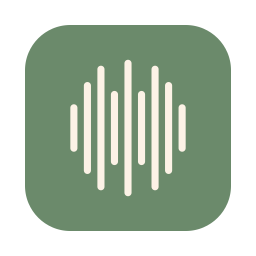

<p align="center">
  
</p>

<h1 align="center">Parola</h1>

<p align="center">
  On-device speech-to-text for macOS — a SwiftUI app and a CLI, built on <a href="https://github.com/argmaxinc/WhisperKit">WhisperKit</a>.
</p>

<p align="center"><sub>Requires macOS 26 on Apple Silicon. MIT licensed.</sub></p>

## Install

Download the latest DMG from [Releases](https://github.com/stefanovalloncini/Parola/releases), open it, and drag Parola to Applications. On first transcription the app downloads a speech model (about 75 MB for the default).

Everything runs locally: audio never leaves your Mac unless you connect a cloud AI provider yourself.

## What it does

- Transcribe audio and video files, YouTube URLs, or a whole batch queue
- Record the microphone or system audio (with meeting detection for Zoom, Teams, Webex, Meet)
- Live streaming transcription with speaker labels, plus on-screen live captions
- System-wide dictation with per-app rules, snippets, and voice commands
- Word-level timestamps, diarization, translation, search across your library
- Export to SRT, VTT, TXT, DOCX, PDF, FCPXML, LRC and more; burn subtitles into video
- Summaries, chapters, and chat over a transcript via Apple Intelligence, Ollama, or cloud models
- App Intents, a `parola` CLI, and an MCP server for automation

## CLI

The release app bundles the CLI at `Parola.app/Contents/MacOS/parola`. To build it from source:

```sh
cd ParolaCore
swift build
.build/debug/parola models download openai_whisper-tiny
.build/debug/parola transcribe audio.wav --model openai_whisper-tiny --language en
```

## Build the app

```sh
cd ParolaApp
xcodegen generate
open ParolaApp.xcodeproj
```

## Use from Claude and other LLMs

Parola speaks MCP over stdio. Point Claude Code at the bundled CLI:

```sh
claude mcp add parola -- /Applications/Parola.app/Contents/MacOS/parola mcp
```

Then ask in plain language: "transcribe ~/Recordings/standup.m4a as SRT next to
the file". Claude calls the engine directly, on device, and gets progress back
while the model runs. [docs/mcp.md](docs/mcp.md) has the setup for Claude
Desktop and other clients, plus the full tool reference.

## License

[MIT](LICENSE)
